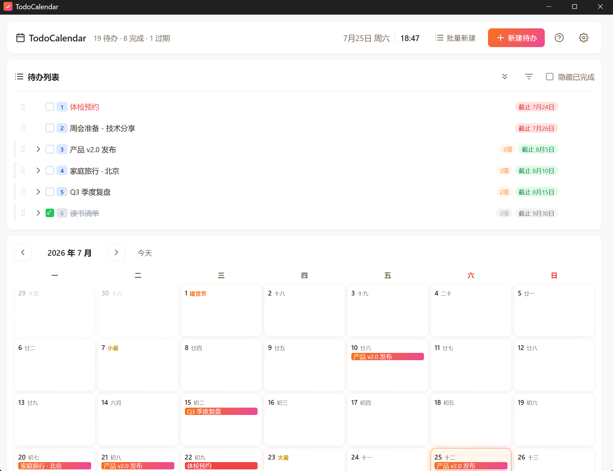
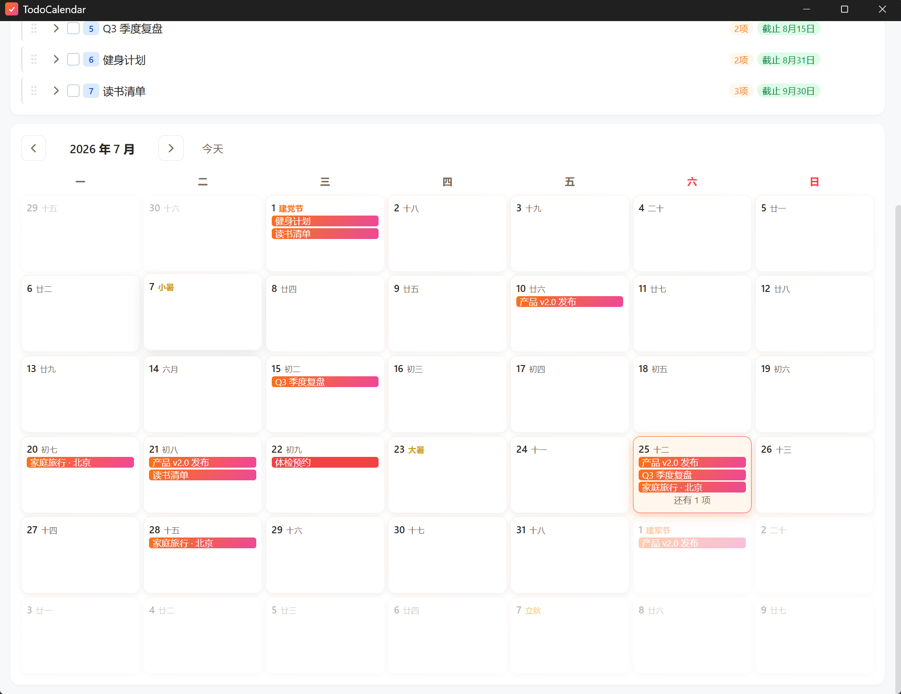
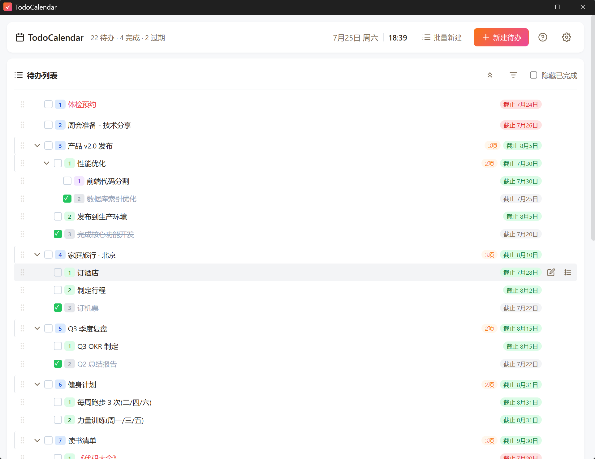
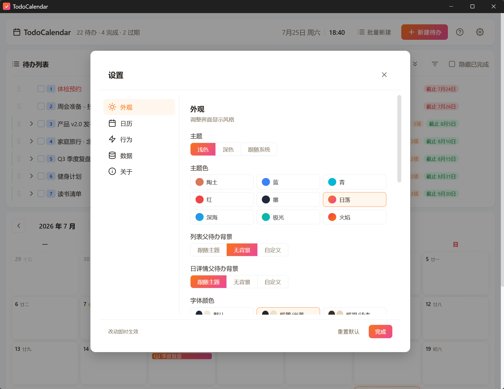
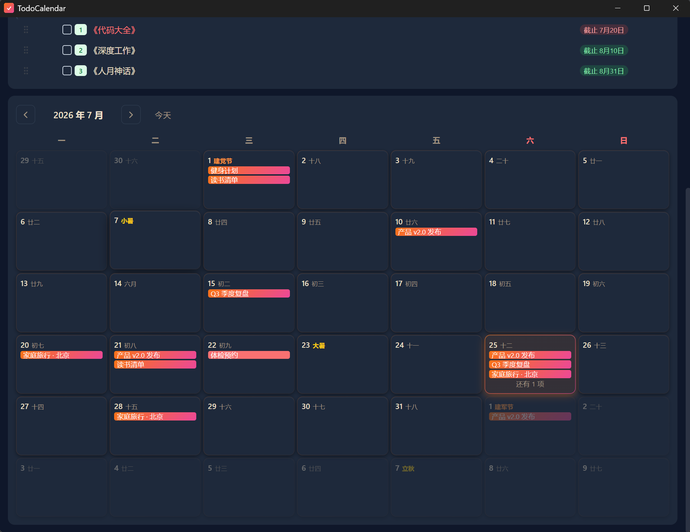

# TodoCalendar

> 极简待办日历
>
> A minimalist local-first desktop calendar + todo app.

<p align="center">
  
</p>

## 核心功能

### 📅 日历

- 月视图,可选农历 / 周数
- 点击日期查看当日详情
- 跨日任务可视化(开始 / 进行中 / 截止)
- 当天截止高亮警示

<p align="center"></p>

### ✅ 待办

- 无限嵌套子任务
- 拖拽排序 / 自动按截止时间
- 批量创建(粘贴缩进文本)
- 自定义分组(Default + 自定义)
- 时间精度切换(日期 / 具体时间)
- 编号样式(WBS / 简单)

<p align="center"></p>

### 🎨 个性化

- 浅 / 深 / 跟随系统 三种主题
- 9 种主题色(纯色 + 渐变)
- 字体大小(小 / 中 / 较大 / 大)
- 字体颜色偏好(默认 + 3 暖色预设)
- 紧凑模式

<p align="center"></p>

### 🌙 深色模式

<p align="center"></p>

### 📦 归档

- 完成后自动归档(可配置天数)
- 历史记录按树形展示
- 时间范围批量删除(二次确认)
- 一键恢复

## 下载

前往 [Releases](../../releases) 下载 Windows 安装包(NSIS `.exe`)。

支持 Windows 10 / 11。

## 隐私

任务、备忘录和设置存于本地，无账号、无遥测。节假日更新会请求 GitHub raw / jsDelivr；手动检查版本会请求 GitHub Releases API。

- Windows: `%APPDATA%\com.todocalendar.app\`
  - `todos.json` — 待办与分组
  - `settings.json` — 偏好设置
  - `memos.json` — 备忘录
  - `backups/` — 自动备份与导入、恢复前的副本

数据 JSON 导出 / 导入包含待办、分组、归档和备忘录，不包含设置，合并为一个文件；本地仍分别保存 todos.json 和 memos.json。兼容旧版任务 JSON，导入旧版文件时保留备忘录和设置。导入前验证所有内容并明确提示覆盖范围，保存恢复副本；多文件写入失败会回滚，异常中断后下次数据操作前恢复原数据。

设置 → 数据中可保存或恢复完整备份，包含任务、备忘录和设置。恢复会覆盖这三项；写入失败会回滚，中断后在下一次数据操作前恢复原数据。原文件损坏时恢复前另保留原始字节副本。

每日自动备份默认关闭。开启后，在每天第一次数据修改前保存完整快照；默认保留 5 份自动备份，可设为 1–100 份。导入、恢复前的副本不参与自动轮换。备份失败时该次修改不会继续。

## 开发

依赖:[Node.js](https://nodejs.org/) 18+、[Rust](https://www.rust-lang.org/tools/install) stable、Windows SDK。

```bash
# 启动开发模式
npx --yes @tauri-apps/cli@2.11.4 dev --config tauri.dev.conf.json

# 构建 release 安装包
npx --yes @tauri-apps/cli@2.11.4 build --bundles nsis
# 输出: src-tauri/target/release/bundle/
```

开发版使用 `com.todocalendar.dev` 独立数据目录，不迁入旧正式数据。Debug 构建会拒绝访问正式标识 `com.todocalendar.app`。

需要全新空数据的人工验证环境时，在仓库目录执行 `powershell -ExecutionPolicy Bypass -File scripts/start-review.ps1`。每次会创建独立的 `com.todocalendar.dev.review-*` 数据目录，显示“修复验证版”窗口，并输出日志和数据目录位置；不读取安装版或已有开发版数据。

验证命令：`cargo test --manifest-path src-tauri/Cargo.toml --locked --offline`、`node --test scripts/storage-errors.test.cjs`。

## 反馈

[新建 Issue](../../issues/new) 报 Bug 或提建议。

## License

[MIT](LICENSE)
